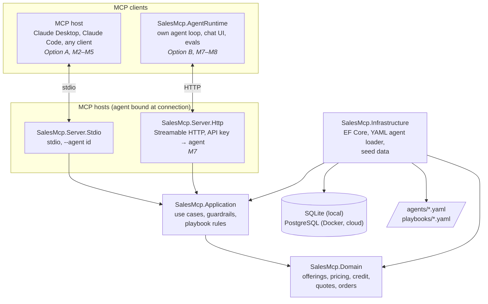

# Sales MCP

[](https://github.com/azharxkhan/sales-mcp/actions/workflows/ci.yml) [](https://github.com/azharxkhan/sales-mcp/actions/workflows/codeql.yml) [](LICENSE) [](global.json)

An open-source **Model Context Protocol (MCP) server for building B2B sales agents**, written in C#/.NET.

Configure an agent (**what** it sells: products, services or subscriptions; **how** it sells: research-backed playbooks such as consultative SPIN or decisive JOLT; its persona; and its guardrails), and any MCP-capable AI becomes that agent. Under the hood is an ERP-grade order engine: quotes, pricing, credit holds, back-orders.

**How to build sales agents people don't hate:** they always disclose that they're AI, answer from one source of truth, hand off to humans easily, and have their guardrails enforced in code, not just prompts.

The repo also works as a **step-by-step course** on building production-quality MCP servers, AI agents (including evaluating them in CI) and the DevOps around them.

> **Status: M1 Domain & data done; M2 First MCP tools in progress.** The server runs over stdio with tools to search the catalog, read the customer and their credit, check stock, price, quote and follow an order, plus read-only resources, on realistic Acme Distributors demo data. The first release, **v0.1.0**, is not tagged yet. See the [roadmap](#roadmap).

## Quick start

You need the [.NET 10 SDK](https://dotnet.microsoft.com/download). Publish the server, then add it to Claude Code as a demo customer (PowerShell):

```powershell
git clone https://github.com/azharxkhan/sales-mcp
```

```powershell
dotnet publish sales-mcp/src/SalesMcp.Server.Stdio -c Release -o "$env:LOCALAPPDATA\Programs\sales-mcp"
```

```powershell
claude mcp add --transport stdio sales-mcp -- dotnet "$env:LOCALAPPDATA\Programs\sales-mcp\SalesMcp.Server.Stdio.dll" --customer KES-001
```

Then ask: *"Find me a cordless drill, tell me the price for two, and quote me for two drills and two 4 Ah batteries."*

- [Claude Desktop setup](docs/setup/claude-desktop.md): config file, customers, database, logs, MCP Inspector
- [Claude Code setup](docs/setup/claude-code.md): also for macOS and Linux
- [Demo](docs/setup/demo.md): what the server returns, step by step

Agent profiles and playbooks arrive in M3; until then `--customer` picks who the conversation serves.

## Architecture



Dependencies point inward: Domain depends on nothing, Application on Domain, Infrastructure implements Application's interfaces, and only the hosts reference the MCP SDK ([ADR-0004](docs/adr/0004-clean-layered-architecture.md)). Architecture tests enforce this in CI.

### What makes it different

The guardrails that matter are designed in, not prompted:

| Rule | Decision |
|---|---|
| Every rule that matters (discount caps, credit holds, value caps, playbook limits) is enforced by the tools, so a model can't talk its way past it | [ADR-0011](docs/adr/0011-guardrails-in-tools-not-prompts.md) |
| The agent is fixed when the connection starts. The model can't switch to a laxer one | [ADR-0012](docs/adr/0012-agent-bound-at-connection.md) |
| Prices and offers exist only as documents the tools create. Chat text is never an offer | [ADR-0015](docs/adr/0015-commitments-only-through-tool-issued-documents.md) |
| The buyer's identity comes from configuration or authentication, never from model arguments | [ADR-0016](docs/adr/0016-customer-bound-to-session.md) |

## Roadmap

| Milestone | Release | Scope | Status |
|---|---|---|---|
| [M0: Foundation](https://github.com/azharxkhan/sales-mcp/milestone/1) | — | Scaffold, quality gates, CI, security scanning, ADRs, community files | ✅ Done |
| [M1: Domain & data](https://github.com/azharxkhan/sales-mcp/milestone/2) | — | Offerings, customers, price resolver with VAT, stock, quotes and orders, Acme Distributors seed data | ✅ Done |
| [M2: First MCP tools](https://github.com/azharxkhan/sales-mcp/milestone/3) | v0.1.0 | Stdio host; catalog, customer, stock, price, quote and order-status tools; integration test harness | 🚧 In progress |
| [M3: Agents & playbooks](https://github.com/azharxkhan/sales-mcp/milestone/4) | v0.2.0 | YAML agents and playbooks with JSON Schema, `--agent` binding, `qualify`, `recommend`, SPIN and JOLT playbooks | ⏳ Planned |
| [M4: Orders & guardrails](https://github.com/azharxkhan/sales-mcp/milestone/5) | v0.3.0 | Quote → order with buyer confirmation, credit holds, back-orders, discount tiers, human handoff, audit log, kill switch | ⏳ Planned |
| [M5: Ship it](https://github.com/azharxkhan/sales-mcp/milestone/6) | **v1.0.0** | Docker, PostgreSQL, release automation, SBOM, image scanning, OpenTelemetry | ⏳ Planned |
| [M6: Services & subscriptions](https://github.com/azharxkhan/sales-mcp/milestone/7) | v1.1.0 | Rate cards and scoping, plans and usage pricing, two more demo businesses and playbooks | ⏳ Planned |
| [M7: Agent runtime](https://github.com/azharxkhan/sales-mcp/milestone/8) | v1.2.0 | Streamable HTTP host, own agent loop with output checks on every reply, web chat UI | ⏳ Planned |
| [M8: Evaluation harness](https://github.com/azharxkhan/sales-mcp/milestone/9) | v1.3.0 | Simulated buyers, graded end states, pass^k reliability, evals in CI | ⏳ Planned |
| [M9: Cloud deploy](https://github.com/azharxkhan/sales-mcp/milestone/10) | v1.4.0 | Terraform on AWS, OIDC deploys, staging → production | ⏳ Planned |
| [M10: Analytics & qualification](https://github.com/azharxkhan/sales-mcp/milestone/11) | v1.5.0 | MEDDPICC deals, qualification scoring, sales summary reports | ⏳ Planned |

Full scope and reasoning: [docs/PLAN.md §9](docs/PLAN.md#9-milestones).

## Build and test

Requires the [.NET 10 SDK](https://dotnet.microsoft.com/download) (pinned in `global.json`).

```bash
dotnet build SalesMcp.slnx
dotnet test --solution SalesMcp.slnx
```

| Project | Role |
|---|---|
| `src/SalesMcp.Domain` | Entities and business rules. No dependencies |
| `src/SalesMcp.Application` | Use cases, guardrail and playbook enforcement. Depends on Domain only |
| `src/SalesMcp.Infrastructure` | EF Core and SQLite, Acme seed data; YAML agent/playbook loading (M3) |
| `src/SalesMcp.Server.Stdio` | MCP host over stdio: tools and resources |
| `tests/*` | xUnit v3 on Microsoft.Testing.Platform. Layering is enforced by architecture tests |

## Docs

| Document | What's in it |
|---|---|
| [Project plan](docs/PLAN.md) | Vision, decisions (ADRs), agent profiles and playbooks, domain model, MCP surface, architecture, evals, DevOps, milestones |
| [Course](docs/course/README.md) | Chapters written alongside the code. Chapters 3 (modelling a sales domain) and 4 (persistence) are drafted |
| [Domain glossary](docs/domain/glossary.md) | Quote, order, hold, back-order, allocation, credit exposure, ATP and the pricing terms, linked to the code |
| [Architecture decisions](docs/adr/README.md) | ADR-0001 to ADR-0016: stack, architecture, transports, agent design and the guardrail core, each with context, trade-offs and alternatives |
| [State of sales 2026](docs/research/sales-landscape-2026.md) | Trends, then vs now, how selling evolved, reading list |
| [AI in sales 2023–2026](docs/research/ai-in-sales-2023-2026.md) | What AI was used for, what worked, quarter-by-quarter timeline, buyer complaints |
| [Fixing AI selling](docs/research/fixing-ai-selling.md) | How each complaint could have been fixed, with cases (Klarna, Air Canada, Artisan) |
| [Classic sales guides](docs/research/classic-sales-guides.md) | Sales guides from 1887 to the 2000s and what they teach about AI-era selling |
| [Sales data & benchmarks](docs/research/sales-data-benchmarks.md) | Win rates, cycles, quota attainment, funnel conversion, AI impact, order-to-cash KPIs |
| [Sales book summaries](docs/research/sales-book-summaries.md) | SPIN, Strategic Selling, MEDDPICC, Sandler, Challenger, Gap, JOLT, Voss, Cialdini and more |
| [ERP order-to-cash](docs/research/erp-order-to-cash.md) | How SYSPRO, SAP, Dynamics 365, Odoo, Sage, Business One, NetSuite, Business Central, Acumatica, Epicor, JD Edwards and Infor model quotes, orders, pricing, credit and back-orders |
| [South African market](docs/research/south-africa-market.md) | SA e-commerce and B2B landscape, VAT, POPIA, CPA/ECTA, with design implications |
| [Guardrails](docs/research/guardrails.md) | Incidents (Chevy $1 Tahoe, Air Canada), OWASP LLM Top 10 and MCP risks, agentic-commerce limits, a 33-item guardrail catalogue by enforcement layer |
| [Guardrail engineering](docs/research/guardrails-engineering.md) | How guardrails are built (classifiers, instruction hierarchy, design patterns, elicitation), bypass categories, and the fix for each |
| [MCP knowledge base](docs/research/mcp-knowledge-base.md) | Curated MCP reading list: spec 2026-07-28, C# SDK 2.x, courses, auth, security |
| [Conversational UX](docs/research/conversational-ux.md) | Why AI and sales agents are hard to talk to (loops, gated pricing, deflection, dark patterns) and 10 design principles |
| [Competitors & existing MCPs](docs/research/competitors-and-existing-mcps.md) | Agentforce, Breeze, CRM/commerce/ERP MCP servers, and the gaps Sales MCP fills |
| [Agent evaluation](docs/research/agent-evaluation.md) | τ-bench, pass^k, grader types, and the M8 harness design (personas, metrics, thresholds, cost) |
| [CPQ, services & subscriptions](docs/research/cpq-services-subscriptions.md) | Configure-price-quote, service pricing models and scoping, subscription/usage billing, M6 domain design |
| [Sales conversation design](docs/research/sales-conversation-design.md) | Discovery question bank, LAER objection handling, negotiation, closing and tone for playbook prompts |

## Why

- 67% of B2B buyers prefer rep-free buying, and 45% used AI in a recent purchase (Gartner, 2026).
- AI agents deliver the most on structured work such as quotes and order fulfilment (Salesforce, 2026).
- 40–60% of lost deals end in "no decision" (*The JOLT Effect*), so *how* an agent sells matters as much as what it knows.
- Buyers distrust AI that's generic, pushy, hidden or impossible to escalate. This project is designed around those lessons.

## How this repo is built

Developed with [Claude Code](https://claude.com/claude-code) as a pair programmer. AI-assisted commits carry a `Co-Authored-By` trailer.

## License

[MIT](LICENSE) © 2026 Azhar Khan.

Please report security problems, including guardrail bypasses, privately as described in [SECURITY.md](SECURITY.md). Taking part in the project means following the [Code of Conduct](CODE_OF_CONDUCT.md).
