# Demo: find a product, price it, create a quote



This is a replay of real responses from the server to these four tool calls, for the demo customer `KES-001`. It shows the tool calls rather than a chat: a host such as Claude makes the calls and words the answers. The data is invented, and its dates follow the day the database was created.

Connect the server first with [the Claude Desktop guide](claude-desktop.md) or [the Claude Code guide](claude-code.md), then ask:

> Find me a cordless drill, tell me the price for two, and quote me for two drills and two 4 Ah batteries.

## 1. Find the product

```text
search_catalog(query: "cordless drill", limit: 3)
```

| SKU | Name |
|---|---|
| `ACM-PTL-101` | Cordless drill driver, 18 V, body only |
| `ACM-PTL-102` | Cordless drill driver, 18 V, with 2 Ah kit |
| `ACM-PTL-103` | Cordless drill driver, 18 V, hammer action, body only |

Search results never carry prices.

## 2. Price it

```text
get_price(offering: "ACM-PTL-101", quantity: 2)
```

| Field | Value |
|---|---|
| Source | Contract price |
| Unit price | ZAR 1,606.50 |
| Net | ZAR 3,213.00 |
| VAT 15% | ZAR 481.95 |
| Total | ZAR 3,694.95 |

```text
check_stock(offering: "ACM-PTL-101", quantity: 2)
```

Availability `now`: two are in stock across the two warehouses.

## 3. Create the quote

```text
create_quote(
  lines: [{offering: "ACM-PTL-101", quantity: 2}, {offering: "ACM-PTL-302", quantity: 2}],
  requestId: "demo-0001")
```

The server returns the figures and the quote document, which is the offer:

> **Quote Q-2026-000297**
> From: Acme Distributors · To: Kestrel Ridge Mining Supplies (account KES-001)
> Issued: 2026-11-28 · Valid until: 2026-12-28

| # | SKU | Item | Quantity | Unit price | Net | VAT | Total |
|---|---|---|---:|---:|---:|---:|---:|
| 1 | ACM-PTL-101 | Cordless drill driver, 18 V, body only | 2 each | ZAR 1,606.50 | ZAR 3,213.00 | VAT 15% ZAR 481.95 | ZAR 3,694.95 |
| 2 | ACM-PTL-302 | Battery pack, 18 V, 4 Ah | 2 each | ZAR 1,186.80 | ZAR 2,373.60 | VAT 15% ZAR 356.04 | ZAR 2,729.64 |

**Total: ZAR 6,424.59** (net ZAR 5,586.60, VAT ZAR 837.99). Payment: 30 days from end of month.

Calling `create_quote` again with the same `requestId` and lines returns the same quote instead of a second one.
